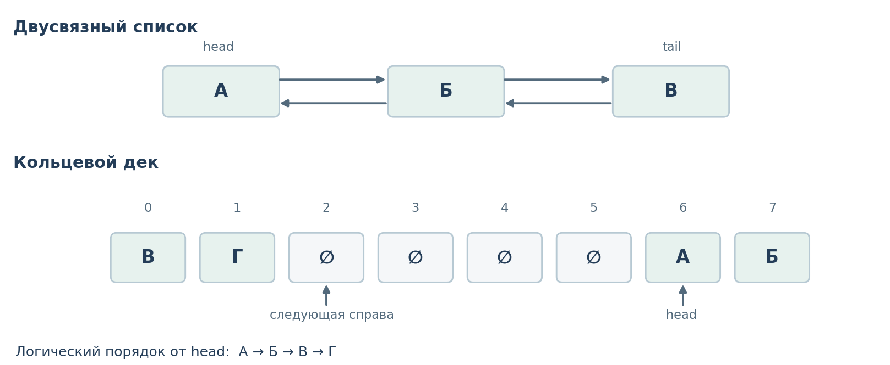
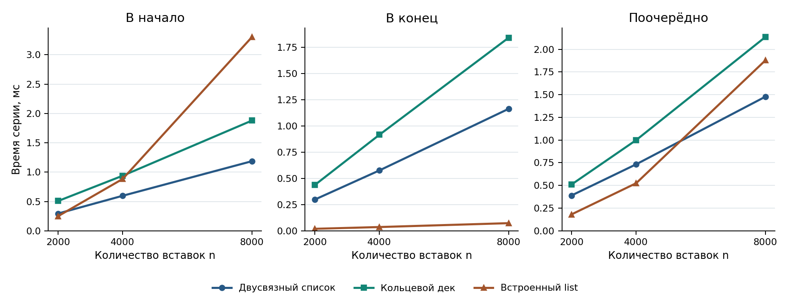
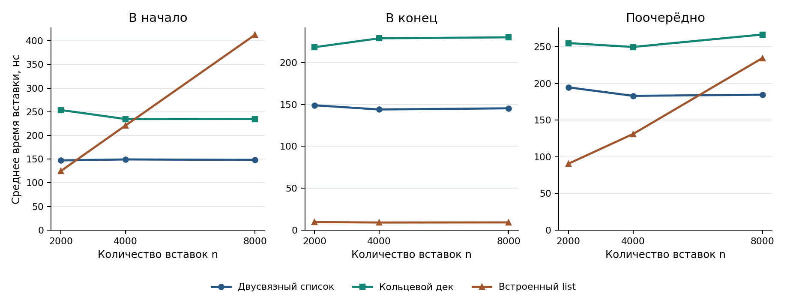

# Лабораторная работа № 6. Реализация линейных структур данных и анализ трудоёмкости их операций

**Вариант 4**  
**Дисциплина** — Основы алгоритмизации и программирование  
**Выполнила** — Булова Екатерина, группа БИ 2-1  
**Направление** — 38.03.05 «Бизнес-информатика», 2 курс

[Скачать отчёт с титульным листом и полным листингом (PDF)](report.pdf)

## Запуск

Требуется Python 3.10 или новее. Из каталога проекта выполните команды.

```bash
python -m pip install -r requirements.txt
python main.py --check
python main.py
```

Быстрая проверка охватывает вставку и удаление на концах, расширение дека, историю страниц, стек и очередь.

Таблицы ниже фиксируют выполненный запуск. Команда `python main.py` записывает новые CSV и графики. Для перестроения графиков по уже сохранённым CSV достаточно `python plots.py`.

## 1. Реализация структур

### Цель и задание варианта 4

Реализовать двусвязный список и дек, сравнить их со встроенным list при вставке с обоих концов. Для 2 000, 4 000 и 8 000 элементов исследуются три режима — вставка в начало, в конец и поочерёдно. Прикладная задача — история посещений с действиями «назад» и «вперёд».

### Узлы и ссылки

Двусвязный список хранит head, tail и размер. Каждый узел содержит значение и ссылки prev и next. При вставке меняются ссылки крайнего узла, нового узла и соответствующего конца. Перепривязка обходится в Θ(1). Поиск узла по индексу начинается с ближайшего конца и в худшем случае занимает Θ(n).



*Рисунок 1. Вверху — узлы и ссылки. Внизу — физические ячейки кольцевого массива при head = 6, size = 4 и capacity = 8. После индекса 7 обход продолжается с нуля.*

### Кольцевой дек

В деке начало задаётся индексом head. Для вставки слева используется (head − 1) mod capacity, справа — (head + size) mod capacity. Полный массив удваивается, элементы переносятся в логическом порядке. Одиночное расширение стоит Θ(n), а вставка с любого конца амортизированно стоит Θ(1).

В общей части также реализованы односвязный список с вставкой, поиском, удалением головы и доступом по индексу, стек на динамическом массиве и очередь с кольцевым буфером. Контрольная программа проверяет для них порядок элементов, LIFO и FIFO.

[Схема вставки в дек](diagrams/storage.md) · [Структуры варианта](structures.py) · [Общая часть](basics.py)

## 2. Проверка операций и история переходов

### Т1. Содержимое после каждого действия

Двенадцать значений добавлены с чередованием сторон, затем удалены крайние. После каждого шага программа сверяет содержимое и размер обеих структур со встроенным list. Начальная ёмкость дека в этом примере равна 4.

| Шаг | Операция | Возврат | Ёмкость | Содержимое обеих структур |
| :---: | :--- | :---: | :---: | :--- |
| 1 | push_front(1) | — | 4 | [1] |
| 2 | push_back(2) | — | 4 | [1, 2] |
| 3 | push_front(3) | — | 4 | [3, 1, 2] |
| 4 | push_back(4) | — | 4 | [3, 1, 2, 4] |
| 5 | push_front(5) | — | 8 | [5, 3, 1, 2, 4] |
| 6 | push_back(6) | — | 8 | [5, 3, 1, 2, 4, 6] |
| 7 | push_front(7) | — | 8 | [7, 5, 3, 1, 2, 4, 6] |
| 8 | push_back(8) | — | 8 | [7, 5, 3, 1, 2, 4, 6, 8] |
| 9 | push_front(9) | — | 16 | [9, 7, 5, 3, 1, 2, 4, 6, 8] |
| 10 | push_back(10) | — | 16 | [9, 7, 5, 3, 1, 2, 4, 6, 8, 10] |
| 11 | push_front(11) | — | 16 | [11, 9, 7, 5, 3, 1, 2, 4, 6, 8, 10] |
| 12 | push_back(12) | — | 16 | [11, 9, 7, 5, 3, 1, 2, 4, 6, 8, 10, 12] |
| 13 | pop_front() | 11 | 16 | [9, 7, 5, 3, 1, 2, 4, 6, 8, 10, 12] |
| 14 | pop_back() | 12 | 16 | [9, 7, 5, 3, 1, 2, 4, 6, 8, 10] |

### Два дека и текущая страница

Ближайшая страница находится справа в каждом деке. «Назад» переносит текущую страницу в future и извлекает крайнюю из past. «Вперёд» делает обратное. Открытие новой страницы очищает future. При попытке выйти за границу сохраняется текущая страница.

| Шаг | Команда | past | Текущая | future |
| :---: | :--- | :--- | :--- | :--- |
| 0 | старт | [] | /home | [] |
| 1 | назад | [] | /home | [] |
| 2 | открыть /catalog | [/home] | /catalog | [] |
| 3 | открыть /item | [/home, /catalog] | /item | [] |
| 4 | назад | [/home] | /catalog | [/item] |
| 5 | вперёд | [/home, /catalog] | /item | [] |
| 6 | назад | [/home] | /catalog | [/item] |
| 7 | открыть /cart | [/home, /catalog] | /cart | [] |
| 8 | вперёд | [/home, /catalog] | /cart | [] |
| 9 | назад | [/home] | /catalog | [/cart] |
| 10 | назад | [] | /home | [/cart, /catalog] |

## 3. Т2 и Т3. Время и трудоёмкость вставки

Среда измерения — Linux, CPython 3.12.14. Каждый опыт начинает с пустой структуры и выполняет ровно n вставок. Значения одинаковы. Таблица показывает медиану 15 повторов после одного прогревочного. Порядок опытов перемешивается. Подготовка данных, создание контейнера, сборка мусора и проверка результата вынесены за границы таймера perf_counter_ns.

| Режим | Структура | Одна вставка | Серия из n | 2 000, мс | 4 000, мс | 8 000, мс | T₈/T₄ |
| :--- | :--- | :---: | :---: | ---: | ---: | ---: | ---: |
| В начало | Двусвязный список | Θ(1) | Θ(n) | 0,294 | 0,597 | 1,186 | 1,99 |
| В начало | Кольцевой дек | Θ(1) ам. | Θ(n) | 0,507 | 0,939 | 1,878 | 2,00 |
| В начало | Встроенный list | Θ(n) | Θ(n²) | 0,249 | 0,884 | 3,300 | 3,73 |
| В конец | Двусвязный список | Θ(1) | Θ(n) | 0,298 | 0,576 | 1,163 | 2,02 |
| В конец | Кольцевой дек | Θ(1) ам. | Θ(n) | 0,437 | 0,915 | 1,840 | 2,01 |
| В конец | Встроенный list | Θ(1) ам. | Θ(n) | 0,019 | 0,036 | 0,073 | 2,03 |
| Поочерёдно | Двусвязный список | Θ(1) | Θ(n) | 0,390 | 0,733 | 1,478 | 2,02 |
| Поочерёдно | Кольцевой дек | Θ(1) ам. | Θ(n) | 0,510 | 1,000 | 2,135 | 2,14 |
| Поочерёдно | Встроенный list | Θ(n) | Θ(n²) | 0,181 | 0,524 | 1,878 | 3,58 |

T₈/T₄ — отношение времени для 8 000 и 4 000 вставок. «ам.» обозначает амортизированную оценку. Для чередования приведена средняя трудоёмкость операции в серии. Ожидаемые отношения при удвоении n близки к 2 для линейной и к 4 для квадратичной серии.



*Рисунок 2. Полное время серии T(n), мс. Для каждого режима выбрана собственная вертикальная шкала.*

### Сопоставление с теорией

При увеличении n с 4 000 до 8 000 серия вставок в голову двусвязного списка стала дольше в 1,99 раза, для list — в 3,73 раза. Список узлов меняет постоянное число ссылок. Встроенный list при очередной вставке слева сдвигает все уже записанные ссылки. При n вставках это n(n − 1)/2 сдвигов.

## 4. Время одной вставки и расход памяти

Деление времени серии на число вставок даёт среднее время одной операции. Плоский участок согласуется с постоянной средней стоимостью, растущий для вставок в начало list — с линейной. Масштаб вертикальной оси свой для каждого режима.



*Рисунок 3. Среднее время вставки T(n)/n, нс. В режиме чередования половина элементов добавляется слева.*

Для list время одной вставки слева выросло с 124,7 до 412,5 нс, а справа изменилось с 9,5 до 9,1 нс. При вставке слева у двусвязного списка измерено от 147,2 нс на 2 000 до 148,2 нс на 8 000 элементах.

### Т4. Память для 10 000 целых значений

| Структура | Объект, Б | Узлы / массив, Б | Структура, Б | Б / элемент | С данными, Б |
| :--- | ---: | ---: | ---: | ---: | ---: |
| Двусвязный список | 56 | 560 000 | 560 056 | 56,01 | 840 056 |
| Кольцевой дек | 56 | 131 128 | 131 184 | 13,12 | 411 184 |
| Встроенный list | 85 176 | 0 | 85 176 | 8,52 | 365 176 |

Замер выполнен функцией sys.getsizeof. Для списка узлов отдельно просуммированы 10 000 объектов Node. Для дека добавлен размер внутреннего массива на 16 384 ссылки. У list массив ссылок уже входит в размер самого объекта. Отдельно стоящие служебные целые и память распределителя в оценку не входят.

Последний столбец прибавляет 280 000 Б — суммарный размер целых 0…9 999. Все структуры ссылаются на один и тот же набор значений. Служебная часть двусвязного списка занимает 560 056 Б из-за заголовка и двух ссылок каждого узла.

### Выбор структуры и вывод

Для истории выбраны два дека. Переход на соседнюю страницу выполняет по одной операции на концах и амортизированно занимает Θ(1). Если после возврата открыть новую страницу, очистка k записей старой ветви требует Θ(k) времени. На шаге 7 открытие /cart удаляет путь к /item, и команда «вперёд» на шаге 8 оставляет /cart текущей.

[Блок-схема истории переходов](diagrams/history.md)

## 5. Контрольные вопросы

**1. Чем АТД отличается от реализации?** Абстрактный тип задаёт операции и их смысл. Например, дек допускает добавление и извлечение с двух сторон. Хранить его элементы можно в двусвязных узлах или в кольцевом массиве.

**2. Что означают LIFO и FIFO?** LIFO выдаёт последним добавленный элемент первым. Так работают стек вызовов и стек отмены действий. FIFO сохраняет очередь поступления, например у заданий печати и заявок на обслуживание.

**3. Почему различается доступ по индексу?** В массиве позиция вычисляется по индексу за Θ(1). В списке приходится переходить по ссылкам от края, в худшем случае Θ(n) раз.

**4. Что такое амортизированная стоимость?** Это общая стоимость последовательности, распределённая на её операции. При геометрическом увеличении буфера за n добавлений копируется O(n) элементов. В среднем на добавление приходится O(1) работы.

**5. Для чего нужна ссылка на хвост?** Она позволяет сразу найти последний узел. Добавить после него новый узел можно за Θ(1).

**6. Что даёт вторая ссылка узла?** Ссылка prev разрешает движение назад, удаление хвоста и удаление известного узла за Θ(1). За это платят памятью и дополнительными обновлениями ссылок.

**7. Как замыкается кольцевой буфер?** Индексы вычисляются по модулю ёмкости. Позиция после последней ячейки снова равна нулю. Размер позволяет различить пустой и полный буфер.

**8. Почему массив бывает быстрее списка узлов?** Ссылки массива лежат рядом, последовательный доступ лучше использует кэш. Связный список выделяет отдельный объект на каждый узел. На абсолютное время влияет и реализация встроенных методов CPython.

**9. Как реализовать очередь двумя стеками?** Элементы добавляют во входной стек. Если выходной стек пуст, входной перекладывают в него и затем извлекают вершину. Каждый элемент переносится один раз, поэтому операция стоит O(1) амортизированно.

**10. Что выбрать для последних 100 событий?** Кольцевой буфер фиксированной ёмкости 100. Новое событие заменяет самое старое за Θ(1). В Python такое поведение также даёт collections.deque(maxlen=100).

### Источники

- Лабораторная работа № 6. Реализация линейных структур данных и анализ трудоёмкости их операций. Методические указания, таблицы 1 и 2.
- [Python 3.12. sys.getsizeof](https://docs.python.org/3.12/library/sys.html#sys.getsizeof)
- [Python 3.12. collections.deque](https://docs.python.org/3.12/library/collections.html#collections.deque)

## Листинг программы и протоколы

| Файл | Содержание |
| :--- | :--- |
| [structures.py](structures.py) | двусвязный список, кольцевой дек и история |
| [basics.py](basics.py) | односвязный список, стек и очередь |
| [main.py](main.py) | примеры, измерения и оценка памяти |
| [plots.py](plots.py) | построение графиков |
| [results/timings.csv](results/timings.csv) | время всех серий и одной операции |
| [results/memory.csv](results/memory.csv) | состав оценки памяти |
| [results/demo.csv](results/demo.csv) | проверка структур по шагам |
| [results/history.csv](results/history.csv) | история переходов |
| [results/run.json](results/run.json) | параметры запуска |
